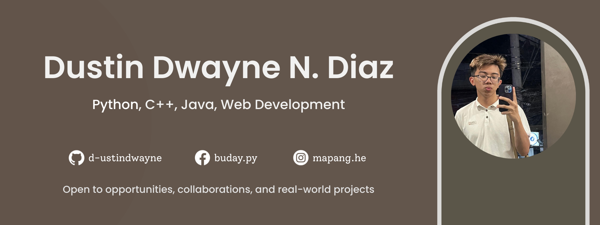

# Dustin Dwayne Diaz

**Software Developer · Web Developer · Programming Language Designer**

I develop software across web, mobile, and systems programming, with a particular interest in building tools and applications from the ground up. My projects range from a statically typed programming language with multiple compilation targets to a cross-platform pixel-art game, e-commerce interfaces, and interactive multi-page websites.

I currently work as a **WordPress Developer at Morley Media**, a **Freelance IT Consultant**, and a **Mathematics Tutor on Superprof**. I am pursuing a Bachelor of Digital Technologies, majoring in Web and Software Development, at Manukau Institute of Technology in New Zealand.

## Featured Projects

### [Dessa — Programming Language](https://github.com/d-ustindwayne/Dessa)

A statically typed programming language designed to make native development more approachable while supporting both native and web execution. Dessa compiles to C, using C++ where necessary, or to JavaScript for Node.js and browser environments.

**Key capabilities**
- Static typing and nil safety, including optional chaining and null-coalescing operators.
- Object-oriented features, including classes, interfaces, enums, lambdas, and named and default arguments.
- Error handling, Unicode-aware text, and runtime checks.
- Native and JavaScript compilation backends designed to produce equivalent program output.
- `.dhtml` web pages written in Dessa, with a browser compiler.
- `riv`, a package manager, alongside libraries for files, time zones, JSON, SQL, HTTP, and other functionality.
- A VS Code extension providing diagnostics, completion, hover information, and go-to-definition support.

**Tech:** C, C++, JavaScript, compiler development, language tooling.

[Repository](https://github.com/d-ustindwayne/Dessa)

### [Medkit Clicker — Cross-Platform Idle Game](https://github.com/d-ustindwayne/Medkit-Clicker)

A nursing-themed, pixel-art idle game in which players heal patients, purchase medical supplies, expand a hospital, unlock achievements, and earn permanent bonuses through rebirths. The game combines incremental progression with room customisation, interactive medical minigames, and an original soundtrack.

**Key features**
- 13 purchasable medical supplies and 13 upgrade boosts.
- 115 achievements, three currencies, and a rebirth progression system.
- Offline progress for up to four hours.
- Hospital progression through 10 visual stages.
- A customisable room with 26 pixel-art decorations and permanent item bonuses.
- Nine patient-treatment minigames.
- Emergency events, redeemable reward codes, and an original five-track lo-fi soundtrack.
- Save persistence, JSON/CSV export and import, and light/dark themes.

Available for Android, iOS, and the web, built using Expo, React Native, React, NativeWind, and Reanimated.

**Tech:** TypeScript, React Native, Expo, NativeWind, Reanimated, Bun.

[Repository](https://github.com/d-ustindwayne/Medkit-Clicker)

### [Beau Cosmetics — E-commerce Application](https://github.com/d-ustindwayne/beau)

A lipstick e-commerce frontend for a cosmetics storefront based in Manukau City, Auckland. The application focuses on product discovery, responsive presentation, and an interactive shopping-cart experience.

**Key features**
- Dynamic product loading from a structured JSON data source.
- An interactive cart sidebar with state-driven updates and entry/exit animations.
- Custom product sorting by alphabetical order, quantity, latest insertion, and deterministic random order.
- TypeScript data models and React hooks for managing application state.
- Utility-first styling with Tailwind CSS.

**Tech:** React, TypeScript, Tailwind CSS, Bun, Vite.

[Repository](https://github.com/d-ustindwayne/beau)

### [Kia Ora Cafe — Multi-Page Website](https://github.com/d-ustindwayne/Kia-Ora-Cafe)

A responsive website for a fictional coffee shop chain connecting New Zealand coffee culture with Filipino hospitality. The site presents the brand, its branches, food and drinks, and coffee workshops through a collection of interconnected pages.

**Key features**
- Responsive layouts and interactive navigation.
- Accordion-based information for 11 fictional branch locations.
- Categorised food and beverage menus.
- Coffee course listings with pricing and descriptions.
- Contact forms with client-side validation.
- An interactive gallery with masonry-style presentation.
- A canvas-based photobooth feature.
- Newsletter form validation, semantic HTML, and keyboard navigation support.

**Tech:** HTML5, CSS3, vanilla JavaScript, Bootstrap 5.

[Repository](https://github.com/d-ustindwayne/Kia-Ora-Cafe) · [Live Demo](https://d-ustindwayne.github.io/Kia-Ora-Cafe-Website/)

### [Personal Portfolio](https://github.com/d-ustindwayne/d-ustindwayne.github.io)

My personal developer portfolio, currently being developed with Astro, TypeScript, and Tailwind CSS. The site serves as a central place to present my projects, technical interests, and development work.

**Tech:** Astro, TypeScript, Tailwind CSS.

[Repository](https://github.com/d-ustindwayne/d-ustindwayne.github.io) · [Live Website](https://d-ustindwayne.github.io/)

### [GaaS-API](https://github.com/d-ustindwayne/GaaS-API)

A public API project associated with gas-station and fuel-price data. The repository is included here as an additional example of my backend development work; its current implementation details should be reviewed directly in the source before describing specific endpoints or capabilities.

**Tech:** .NET, C#, API development.

[Repository](https://github.com/d-ustindwayne/GaaS-API)

## Technical Stack

### Programming Languages

### Frontend & Mobile Development

### Backend, Databases & Cloud

### Tools & Environments

## GitHub Analytics

  
  

  

  

*Statistics are generated by third-party services and may change or become temporarily unavailable. Language distributions reflect repository code, not individual proficiency.*

## Connect

You can also find me on [Facebook](https://facebook.com/buday.py) and [Instagram](https://instagram.com/mapang.he).

---

  <i>Building software across languages, platforms, and ideas.</i>

